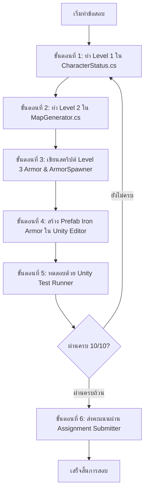

# 📖 คำแนะนำข้อสอบปฏิบัติกลางภาค (Midterm Practical Exam Guide) - Week 08
## วิชา: Basic Game Programming (การเขียนโปรแกรมเกมเบื้องต้น)

---

## 📋 1. ภาพรวมและข้อมูลสำคัญของการสอบ

การสอบกลางภาค (Midterm Examination) วิชา Basic Game Programming แบ่งออกเป็น **2 ส่วนหลัก** เพื่อวัดผลทั้งภาคทฤษฎีและทักษะการปฏิบัติ:

1. **ส่วนที่ 1: ข้อสอบปรนัย (ข้อกา) จำนวน 60 ข้อ**
   - ทำผ่านระบบ [Google Forms (คลิกทำข้อสอบปรนัยที่นี่)](https://docs.google.com/forms/d/1D0xN9Uz1ElU1Y5dktE9bmrGWpU1B0RtkPtjpXGEZCgw/viewform)
   - ครอบคลุมเนื้อหาความรู้พื้นฐานการเขียนโปรแกรมภาษา C# และ Unity Engine (Week 01 – 07)
2. **ส่วนที่ 2: ข้อสอบปฏิบัติ (Practical Exam บน Unity) จำนวน 3 ข้อใหญ่ (3 Levels)**
   - วัดทักษะการเขียนโค้ดและการสร้างระบบเกมจริงบน Unity Engine แบ่งออกเป็น **3 ระดับ (Level 1 – 3)** รวม **10 ข้อทดสอบ (10 คะแนนเต็ม)**
   - ตรวจผลผ่าน Unity Test Runner (EditMode) และส่งผลคะแนนผ่านระบบ Submitter

> [!IMPORTANT]
> **นโยบายความซื่อสัตย์ทางวิชาการ (Academic Integrity):**
> - นักศึกษาต้องทำข้อสอบทั้งข้อกาและข้อปฏิบัติด้วยความรู้ความสามารถของตนเอง
> - ไม่อนุญาตให้คัดลอก ดัดแปลง หรือใช้เครื่องมือ AI ช่วยสร้างโค้ดเฉลยลงในไฟล์ข้อสอบ
> - การส่งผลคะแนนจะถูกบันทึกเวลาและประวัติการรันผ่านระบบ Submitter อย่างโปร่งใส

---

## 🎯 2. สรุปรายการไฟล์และคะแนนแต่ละระดับ

| ระดับ | ไฟล์ที่ต้องเขียน / ดำเนินการ | Namespace | หัวข้อหลักที่วัดผล | คะแนน |
| :---: | :---| :---: | :---| :---: |
| **Level 1** | `CharacterStatus.cs` | `Week08.Ex01` | ตัวแปรคลาส, เมธอดแบบไม่คืนค่า (`void`) และเมธอดแบบคืนค่า | 3 คะแนน |
| **Level 2** | `MapGenerator.cs` | `Week08` | ตาราง 2 มิติ (2D Grid), Nested Loop, เรดาร์ตรวจจับไอเทมและภัยคุกคาม | 4 คะแนน |
| **Level 3** | สร้างสคริปต์ขึ้นมาเอง (เช่น `Armor.cs`, `ArmorSpawner.cs`) + Prefab `Iron Armor.prefab` | `Week08.Ex03` | Custom Class, Trigger Collision, Spawner (`Instantiate`), การสร้าง Prefab | 3 คะแนน |
| **รวม** | **3 ส่วนหลัก** | - | **ครอบคลุมเนื้อหา Week 01 - 07** | **10 คะแนน** |

---

## 🗺️ 3. แผนผังความสัมพันธ์ของระบบในเกม (System Architecture)

ระบบในฉากประกอบด้วยการทำงานร่วมกันของ 3 ส่วนหลัก ดังนี้:

1. **ผู้เล่น (Player & CharacterStatus):**
   - คอมโพเนนต์ `Player` ในฉากจะเรียกใช้ข้อมูลสถานะจากคอมโพเนนต์ `CharacterStatus` (เข้าถึงพลังโจมตี `attackPoint` และพลังป้องกัน `defensePoint`)
2. **เครื่องสร้างแผนที่และเรดาร์ (MapGenerator & Dungeon Radar):**
   - จัดการสร้างพื้น ผนัง ทางออก และคำนวณตำแหน่งบนตาราง 2 มิติ (`mapGrid`)
   - มีเมธอดเรดาร์ช่วยค้นหาพิกัดไอเทม ตรวจนับจำนวน และตรวจจับภัยคุกคามรอบตัวผู้เล่น 8 ทิศทาง
3. **ไอเทมเกราะและระบบเสกวัตถุ (Armor, ArmorSpawner & Prefab):**
   - ในขั้นตอนสร้างฉาก `MapGenerator` จะเรียกใช้ `ArmorSpawner` เพื่อเสกสร้าง `Iron Armor.prefab` ลงบนตาราง
   - เมื่อ `Player` เดินชนเกราะ เมธอด `OnTriggerEnter2D` ของ `Armor` จะเพิ่มค่า `defensePoint` ให้กับผู้เล่น และทำลายไอเทมตัวเองออกจากฉาก

---

## 🛠️ 4. ลำดับขั้นตอนการทำข้อสอบ (Step-by-Step Workflow)

เพื่อความต่อเนื่องและลดข้อผิดพลาด แนะนำให้นักศึกษาทำตามขั้นตอนดังต่อไปนี้:

### ขั้นตอนที่ 1: เขียนคลาสสถานะตัวละคร (Level 1)
- เปิดไฟล์ `Assets/Scripts/Workspace/Week08/CharacterStatus.cs`
- เติมโค้ดในเมธอด `TakeDamage(int damage)`, `IsAlive()`, และ `CalculateDamage(int rawDamage, int defense)` ตามโจทย์

### ขั้นตอนที่ 2: เขียนฟังก์ชันเรดาร์สำรวจตาราง (Level 2)
- เปิดไฟล์ `Assets/Scripts/Workspace/Week08/MapGenerator.cs`
- เติมโค้ดในเมธอด `FindItemPosition`, `CountItems`, `ScanThreats`, และ `FindPlayerPosition` โดยใช้ข้อมูลจาก `mapGrid` 2 มิติ

### ขั้นตอนที่ 3: สร้างสคริปต์ไอเทมเกราะและตัวเสกวัตถุ (Level 3)
- สร้างไฟล์สคริปต์ C# ใหม่ในโฟลเดอร์ `Assets/Scripts/Workspace/Week08/` (เช่น `Armor.cs` หรือ `ArmorSpawner.cs`)
- กำหนด namespace เป็น `Week08.Ex03`
- ประกาศคลาส `Armor : MonoBehaviour` พร้อมตัวแปรและเมธอด `OnTriggerEnter2D`
- ประกาศคลาส `ArmorSpawner : MonoBehaviour` พร้อมเมธอด `SpawnArmor(GameObject prefab, Vector3 spawnPosition)`

### ขั้นตอนที่ 4: สร้าง Prefab เกราะใน Unity Editor (Level 3)
1. ในหน้าต่าง **Hierarchy** คลิกขวาเลือก `Create Empty` ตั้งชื่อ GameObject ว่า `Iron Armor`
2. เพิ่มคอมโพเนนต์ **Sprite Renderer** แล้วเลือก Sprite รูปเกราะ (`Iron Armor.png` จากโฟลเดอร์ `Assets/Sprite/Cainos/Pixel Art Icon Pack - RPG/Texture/Equipment/`)
3. เพิ่มคอมโพเนนต์ **Box Collider 2D** และ**ติ๊กถูกที่ช่อง `Is Trigger`**
4. แนบคอมโพเนนต์สคริปต์ `Armor` (`Week08.Ex03.Armor`) ตรวจสอบว่า Name = `"Iron Armor"` และ defenseBonus = `10`
5. ลาก GameObject `Iron Armor` จาก Hierarchy ไปวางในโฟลเดอร์ `Assets/Prefabs/Exam/` เพื่อสร้างเป็นไฟล์ Prefab `Iron Armor.prefab`

---

## 🧪 5. การตรวจสอบความถูกต้องผ่าน Test Runner

นักศึกษาสามารถตรวจสอบคะแนนและความถูกต้องของโค้ดได้ตลอดเวลาผ่าน Unity Test Runner:

1. ไปที่แถบเมนูด้านบนของ Unity: **Window** > **General** > **Test Runner**
2. เลือกแท็บ **EditMode**
3. คลี่โฟลเดอร์ค้นหาหัวข้อ **`Week08_Exam`**
4. กดปุ่ม **Run All** เพื่อรันชุดทดสอบทั้งหมด
5. ผลลัพธ์จะแสดงไฟเขียว (Passed) สำหรับข้อที่ถูกต้อง และไฟแดง (Failed) พร้อมข้อความแจ้งเตือนสำหรับข้อที่ต้องแก้ไข

---

## 📤 6. วิธีการส่งคะแนนเข้าสู่ระบบ (Submission)

เมื่อทดสอบโค้ดและพอใจกับผลคะแนนแล้ว ให้ส่งคะแนนตามขั้นตอนดังนี้:

1. เปิด Scene ของสัปดาห์ที่ 8 หรือ Scene หลักสำหรับการทดสอบ
2. ตรวจสอบว่ามี GameObject ที่แนบคอมโพเนนต์ **`Assignment_Submitter_Week08`** อยู่ในฉาก
3. ในหน้าต่าง **Inspector** กรอกข้อมูลส่วนตัวให้ครบถ้วน:
   - **Student ID:** รหัสนักศึกษา (เช่น `6601234567`)
   - **Student Name:** ชื่อ - นามสกุล (ภาษาไทยหรืออังกฤษ)
   - **Section:** กลุ่มเรียน (เช่น `1` หรือ `2`)
4. กดปุ่ม **"📤 ส่งงานเข้า Google Sheet (Week 08)"**
5. ตรวจสอบข้อความตอบรับใน Console ว่าการส่งข้อมูลเสร็จสมบูรณ์เรียบร้อย

> [!TIP]
> ศึกษารายละเอียดเงื่อนไขและข้อกำหนดทางเทคนิคฉบับสมบูรณ์ได้ที่ไฟล์ [`Requirements.md`](file:///d:/Unity/2569-IGD-23267-Basic-Game-Programming/Assets/Scripts/Workspace/Week08/Requirements.md)
