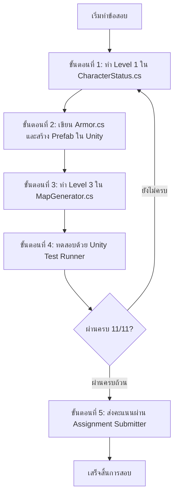

# 📖 คำแนะนำข้อสอบปฏิบัติกลางภาค (Midterm Practical Exam Guide) - Week 08
## วิชา: Basic Game Programming (การเขียนโปรแกรมเกมเบื้องต้น)

---

## 📋 1. ภาพรวมและข้อมูลสำคัญของการสอบ

การสอบกลางภาค (Midterm Examination) วิชา Basic Game Programming แบ่งออกเป็น **2 ส่วนหลัก** เพื่อวัดผลทั้งภาคทฤษฎีและทักษะการปฏิบัติ:

1. **ส่วนที่ 1: ข้อสอบปรนัย (ข้อกา) จำนวน 60 ข้อ**
   - ทำผ่านระบบ [Google Forms (คลิกทำข้อสอบปรนัยที่นี่)](https://docs.google.com/forms/d/1D0xN9Uz1ElU1Y5dktE9bmrGWpU1B0RtkPtjpXGEZCgw/viewform)
   - ครอบคลุมเนื้อหาความรู้พื้นฐานการเขียนโปรแกรมภาษา C# และ Unity Engine (Week 01 – 07)
2. **ส่วนที่ 2: ข้อสอบปฏิบัติ (Practical Exam บน Unity) จำนวน 3 ข้อใหญ่ (3 Levels)**
   - วัดทักษะการเขียนโค้ดและการสร้างระบบเกมจริงบน Unity Engine แบ่งออกเป็น **3 ระดับ (Level 1 – 3)** รวม **11 ข้อทดสอบ (11 คะแนนเต็ม)**
   - ตรวจผลผ่าน Unity Test Runner (EditMode) และส่งผลคะแนนผ่านระบบ Submitter

> [!IMPORTANT]
> **นโยบายความซื่อสัตย์ทางวิชาการ (Academic Integrity):**
> - นักศึกษาต้องทำข้อสอบทั้งข้อกาและข้อปฏิบัติด้วยความรู้ความสามารถของตนเอง
> - ไม่อนุญาตให้คัดลอก ดัดแปลง หรือใช้เครื่องมือ AI ช่วยสร้างโค้ดเฉลยลงในไฟล์ข้อสอบ
> - การส่งผลคะแนนจะถูกบันทึกเวลาและประวัติการรันผ่านระบบ Submitter อย่างโปร่งใส

---

## 🎯 2. สรุปรายการไฟล์และคะแนนแต่ละระดับ

| ระดับ | ไฟล์ที่ต้องเขียน / ดำเนินการ | Namespace | หัวข้อหลักที่วัดผล | คะแนน |
| :---: | :---| :---: | :---| :---: |
| **Level 1** | `CharacterStatus.cs` | `Week08.Ex01` | ตัวแปรคลาส, เมธอดแบบไม่คืนค่า (`void`) และเมธอดแบบคืนค่า | 4 คะแนน |
| **Level 2** | สร้างสคริปต์ `Armor.cs` + ประกอบ Prefab `Iron Armor.prefab` | `Week08` | Custom Class, ตัวแปร, Trigger Collision, การสร้าง Prefab | 3 คะแนน |
| **Level 3** | `MapGenerator.cs` | `Week08` | ตาราง 2 มิติ (2D Grid), จัดวางทางออก (PlaceExit), วางไอเทมเกราะ (PlaceArmor), สร้างกำแพงรูปตัว L (GenerateLWall), เรดาร์ ScanThreats และคอมเมนต์ปิด SpawnItemPotions | 5 คะแนน |
| **รวม** | **3 ส่วนหลัก** | - | **ครอบคลุมเนื้อหา Week 01 - 07** | **12 คะแนน** |

---

## 🗺️ 3. แผนผังความสัมพันธ์ของระบบในเกม (System Architecture)

ระบบในฉากประกอบด้วยการทำงานร่วมกันของ 3 ส่วนหลัก ดังนี้:

1. **ผู้เล่น (Player & CharacterStatus - Level 1):**
   - คอมโพเนนต์ `Player` ในฉากจะเรียกใช้ข้อมูลสถานะจากคอมโพเนนต์ `CharacterStatus` (เข้าถึงพลังโจมตี `attackPoint` และพลังป้องกัน `defensePoint`)
2. **ไอเทมเกราะและ Prefab (Armor & Prefab - Level 2):**
   - มีคลาส `Armor` และ Prefab `Iron Armor.prefab`
   - เมื่อ `Player` เดินชนเกราะ เมธอด `OnTriggerEnter2D` ของ `Armor` จะเพิ่มค่า `defensePoint` ให้กับผู้เล่น และทำลายไอเทมตัวเองออกจากฉาก
3. **เครื่องสร้างแผนที่และเรดาร์ (MapGenerator & Object Placement - Level 3):**
   - จัดการสร้างพื้น ผนัง ทางออก (`PlaceExit`) สุ่มวางเกราะ (`PlaceArmor`) สร้างกำแพงรูปตัว L (`GenerateLWall`)
   - มีเมธอดเรดาร์ (`ScanThreats`) ตรวจจับภัยคุกคามรอบตัวผู้เล่น 8 ทิศทาง
   - ปิดการทำงานของฟังก์ชันเสกยาฟื้นพลัง (`SpawnItemPotions`) เมื่อสร้างแผนที่

---

## 🛠️ 4. ลำดับขั้นตอนการทำข้อสอบ (Step-by-Step Workflow)

เพื่อความต่อเนื่องและลดข้อผิดพลาด แนะนำให้นักศึกษาทำตามขั้นตอนดังต่อไปนี้:



### ขั้นตอนที่ 1: เขียนคลาสสถานะตัวละคร (Level 1 - 4 คะแนน)
- เปิดไฟล์ `Assets/Scripts/Workspace/Week08/CharacterStatus.cs` (namespace `Week08.Ex01`)
- ดำเนินการเขียนโค้ดตาม 4 ข้อย่อย:
  1. **1.1 ตัวแปรสถานะตัวละคร (Fields - `Lv1_01`):** ประกาศตัวแปร `public` ทั้งหมด 6 ตัวแปรพร้อมค่าเริ่มต้น (`characterName` = `"Hero"`, `maxHealth` = `100`, `currentHealth` = `100`, `isAlive` = `true`, `attackPoint` = `10`, `defensePoint` = `0`)
  2. **1.2 เมธอดไม่คืนค่า (Void Method - `Lv1_02`):** เขียนเมธอด `TakeDamage(int damage)` เพื่อลดเลือด, ป้องกันเลือดติดลบ (`currentHealth = 0`), ปรับ `isAlive = false` และพิมพ์ข้อความตามเงื่อนไข
  3. **1.3 เมธอดคืนค่าสถานะ (Return Method - `Lv1_03`):** เขียนเมธอด `IsAlive()` คืนค่า `bool` (`true` เมื่อเลือด > 0, `false` เมื่อเลือด <= 0)
  4. **1.4 เมธอดคำนวณดาเมจ (Return Method - `Lv1_04`):** เขียนเมธอด `CalculateDamage(int rawDamage, int defense)` คำนวณดาเมจสุทธิ `rawDamage - defense` โดยไม่ติดลบ (clamp 0) และคืนค่า `int`

### ขั้นตอนที่ 2: สร้างสคริปต์ไอเทมเกราะและประกอบ Prefab (Level 2 - 3 คะแนน)
1. **สร้างสคริปต์และตัวแปรของ `Armor` (`Lv2_01`):**
   - สร้างไฟล์สคริปต์ C# ใหม่ `Armor.cs` ในโฟลเดอร์ `Assets/Scripts/Workspace/Week08/`
   - **คำแนะนำ:** ด้านบนสุดของไฟล์ให้เพิ่ม `using Week08;` เพื่อเรียกใช้งานคลาส `Player` (หรือครอบด้วย `namespace Week08`):
     ```csharp
     using UnityEngine;
     using Week08; // เพื่อเรียกใช้คลาส Player

     public class Armor : MonoBehaviour
     {
         public string Name = "Iron Armor";
         public int defenseBonus = 10;
         ...
     }
     ```
   - ประกาศตัวแปร `public string Name = "Iron Armor";` และ `public int defenseBonus = 10;`
2. **เขียนเมธอดตรวจจับการชน `OnTriggerEnter2D` (`Lv2_02`):**
   - เขียนเมธอด `private void OnTriggerEnter2D(Collider2D other)` ในคลาส `Armor`
   - พิมพ์ข้อความ `Debug.Log($"[Trigger] {gameObject.name} collided with {other.gameObject.name}");`
   - ตรวจสอบคอมโพเนนต์ `Player` จาก `other.GetComponent<Player>()`
   - เมื่อชนผู้เล่น ให้เพิ่มค่าพลังป้องกันด้วย `player.IncreaseDefense(defenseBonus);` (หรือ `player.defensePoint += defenseBonus;`)
   - พิมพ์ข้อความ `Debug.Log($"Picked up {Name}! +{defenseBonus} Defense");`
   - ทำลายไอเทมเกราะตนเองออกจากฉากด้วย `Destroy(gameObject);`
3. **สร้าง Prefab เกราะใน Unity Editor (`Lv2_03`):**
   - ในหน้าต่าง **Hierarchy** คลิกขวาเลือก `Create Empty` ตั้งชื่อ GameObject ว่า `Iron Armor`
   - เพิ่มคอมโพเนนต์ **Sprite Renderer** แล้วเลือก Sprite รูปเกราะ (`Iron Armor.png` จากโฟลเดอร์ `Assets/Sprite/Cainos/Pixel Art Icon Pack - RPG/Texture/Equipment/`)
   - เพิ่มคอมโพเนนต์ **Box Collider 2D** และ**ติ๊กถูกที่ช่อง `Is Trigger`**
   - แนบคอมโพเนนต์สคริปต์ `Armor` ตรวจสอบว่า Name = `"Iron Armor"` และ defenseBonus = `10`
   - ลาก GameObject `Iron Armor` จาก Hierarchy ไปวางในโฟลเดอร์ `Assets/Prefabs/Exam/` เพื่อสร้างเป็นไฟล์ Prefab `Iron Armor.prefab`

### ขั้นตอนที่ 3: เขียนฟังก์ชันสร้างฉากและจัดวางตำแหน่งออบเจกต์ (Level 3 - 5 คะแนน)
- เปิดไฟล์ `Assets/Scripts/Workspace/Week08/MapGenerator.cs` (namespace `Week08`)
- ดำเนินการใน 5 ข้อย่อยตามลำดับ:
  1. **3.1 `PlaceExit()` (`Lv3_01`):** เสกสร้างทางออกจาก `exitPrefab` ไปยังตำแหน่ง `exitPos` (ตั้งชื่อ Object ว่า `"Exit"`)
  2. **3.2 `PlaceArmor()` (`Lv3_02`):** วางไอเทมเกราะจำนวน `armorCount` ชิ้นแบบสุ่มลงบนตำแหน่งพื้นในตาราง และเก็บไว้ใต้ `itemParent`
  3. **3.3 `GenerateLWall()` (`Lv3_03`):** สร้างแนวกำแพงรูปตัว L (แนวตั้งสูง `rows / 2` ที่คอลัมน์ `columns / 2` และแนวนอนยาว `columns / 2` ที่แถว `rows / 2`) เก็บไว้ใต้ `wallParent`
  4. **3.4 `ScanThreats(Vector2Int playerPos, int threatCode)` (`Lv3_04`):** ค้นหาและนับจำนวนช่องที่มีค่าเท่ากับ `threatCode` รอบตัวผู้เล่น 8 ทิศทาง พร้อมตรวจสอบขอบเขตตารางอย่างรัดกุม
  5. **3.5 คอมเมนต์ปิดการเสกยา (`Lv3_05`):** ในเมธอด `GenerateMap()` ให้ใส่เครื่องหมาย `//` ปิดบรรทัด `SpawnItemPotions();` เพื่อไม่ให้มี Blue Potion หรือ Red Potion ในฉาก

---

## 🧪 5. การตรวจสอบความถูกต้องผ่าน Test Runner (12 Test Cases)

นักศึกษาสามารถตรวจสอบคะแนนและความถูกต้องของโค้ดได้ตลอดเวลาผ่าน Unity Test Runner:

1. ไปที่แถบเมนูด้านบนของ Unity: **Window** > **General** > **Test Runner**
2. เลือกแท็บ **EditMode**
3. คลี่โฟลเดอร์ค้นหาหัวข้อ **`Week08_Exam`**
4. กดปุ่ม **Run All** เพื่อรันชุดทดสอบทั้งหมด
5. ผลลัพธ์จะแสดงไฟเขียว (Passed) สำหรับข้อที่ถูกต้อง และไฟแดง (Failed) พร้อมข้อความแจ้งเตือนสำหรับข้อที่ต้องแก้ไข

### 📊 ตารางสรุป 12 Test Cases และเกณฑ์คะแนน

| ระดับ | ชื่อ Test Case | เกณฑ์การตรวจวัดผล | คะแนน |
| :---: | :---| :---| :---: |
| **Level 1** | `Lv1_01_CharacterStatus_FieldsExistAndDefaultValues` | ตรวจสอบตัวแปร 6 ตัวและค่าเริ่มต้นใน `CharacterStatus` | 1 คะแนน |
| **Level 1** | `Lv1_02_TakeDamage_VoidMethod` | ตรวจสอบเมธอด `TakeDamage` (ลด HP, clamp ไม่ติดลบ, ปรับ `isAlive`) | 1 คะแนน |
| **Level 1** | `Lv1_03_IsAlive_ReturnMethod` | ตรวจสอบเมธอด `IsAlive()` (คืนค่า `bool` ตามสถานะเลือด) | 1 คะแนน |
| **Level 1** | `Lv1_04_CalculateDamage_ReturnMethod` | ตรวจสอบเมธอด `CalculateDamage(rawDamage, defense)` (คำนวณและไม่ติดลบ) | 1 คะแนน |
| **Level 2** | `Lv2_01_Armor_Fields` | ตรวจสอบคลาส `Armor` และฟิลด์ `Name`, `defenseBonus` พร้อมค่าเริ่มต้น | 1 คะแนน |
| **Level 2** | `Lv2_02_Armor_OnTriggerEnter2D` | ตรวจสอบเมธอด `OnTriggerEnter2D` เมื่อชน Player เพิ่ม Defense และ Destroy ตนเอง | 1 คะแนน |
| **Level 2** | `Lv2_03_Armor_Prefab_Configuration` | ตรวจสอบไฟล์ Prefab `Iron Armor.prefab` (Sprite, Collider Trigger, คอมโพเนนต์ Armor) | 1 คะแนน |
| **Level 3** | `Lv3_01_MapGenerator_PlaceExit` | ตรวจสอบเมธอด `PlaceExit` ในการเสกทางออกที่ตำแหน่ง `exitPos` | 1 คะแนน |
| **Level 3** | `Lv3_02_MapGenerator_PlaceArmor` | ตรวจสอบเมธอด `PlaceArmor` ในการสุ่มวางเกราะลงใน `itemParent` | 1 คะแนน |
| **Level 3** | `Lv3_03_MapGenerator_GenerateLWall` | ตรวจสอบเมธอด `GenerateLWall` ในการสร้างกำแพงรูปตัว L | 1 คะแนน |
| **Level 3** | `Lv3_04_MapGenerator_ScanThreats` | ตรวจสอบเมธอดเรดาร์ `ScanThreats` รอบตัว 8 ทิศทาง | 1 คะแนน |
| **Level 3** | `Lv3_05_MapGenerator_DisableSpawnItemPotions` | ตรวจสอบการคอมเมนต์ปิด `SpawnItemPotions()` ใน `GenerateMap()` ไม่ให้มี Blue Potion หรือ Red Potion ในฉาก | 1 คะแนน |
| **รวม** | **12 Test Cases** | **ทดสอบผ่าน Unity Test Runner (EditMode)** | **12 คะแนน** |

---

## 📤 6. วิธีการส่งคะแนนเข้าสู่ระบบ (Submission)

เมื่อทดสอบโค้ดและพอใจกับผลคะแนนแล้ว ให้ส่งคะแนนตามขั้นตอนดังนี้:

1. เปิด Scene ของสัปดาห์ที่ 8 หรือ Scene หลักสำหรับการทดสอบ
2. ตรวจสอบว่ามี GameObject ที่แนบคอมโพเนนต์ **`Assignment_Submitter_Week08`** อยู่ในฉาก
3. ในหน้าต่าง **Inspector** กรอกข้อมูลส่วนตัวให้ครบถ้วน:
   - **Student ID:** รหัสนักศึกษา (เช่น `6601234567`)
   - **Student Name:** ชื่อ - นามสกุล (ภาษาไทยหรืออังกฤษ)
   - **Section:** กลุ่มเรียน (เช่น `1` หรือ `2`)
4. กดปุ่ม **"📤 ส่งงานเข้า Google Sheet (Week 08)"**
5. ตรวจสอบข้อความตอบรับใน Console ว่าการส่งข้อมูลเสร็จสมบูรณ์เรียบร้อย

> [!TIP]
> ศึกษารายละเอียดเงื่อนไขและข้อกำหนดทางเทคนิคฉบับสมบูรณ์ได้ที่ไฟล์ [`Requirements.md`](file:///d:/Unity/2569-IGD-23267-Basic-Game-Programming/Assets/Scripts/Workspace/Week08/Requirements.md)
